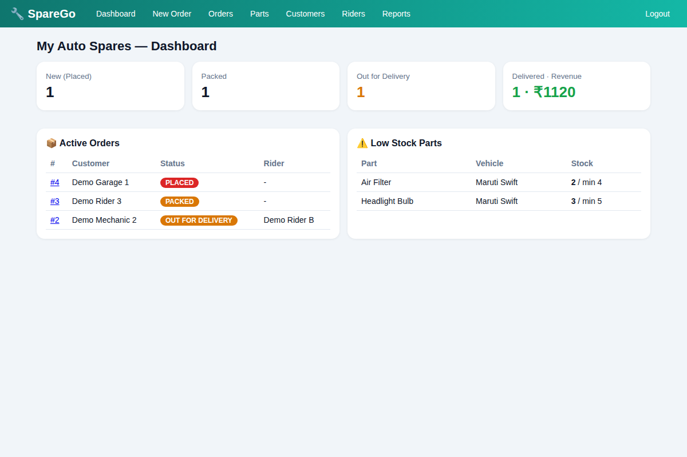

# 🔧 SpareGo — Spare Parts Order & Delivery System

Field Project (CA-310) · Python · Flask · SQLite

Digitises how a local auto-spare-parts shop takes orders and delivers to mechanics, garages and vehicle owners.

## Features
- 🔎 Parts catalogue searchable by **vehicle model**, brand or part name
- ⚠️ Low-stock alerts, restock, automatic stock deduction
- 🧾 Orders with printable invoice, delivery-fee rule (free above ₹1000)
- 🔄 Order life cycle: Placed → Packed → Out for Delivery → Delivered (rider mandatory)
- 🔐 **Delivery OTP**: order is delivered only when the customer's OTP matches
- 🌐 **Public tracking page** (order no. + phone) + one-click **WhatsApp tracking link**
- 📊 Dashboard, most-ordered parts, **rider performance** (avg delivery time), 7-day order value

## Run
```bash
python -m venv .venv && source .venv/bin/activate   # Windows: .venv\Scripts\activate
pip install -r requirements.txt
python seed.py     # optional demo data
python app.py      # http://127.0.0.1:5000   login: admin / admin123
python tests.py    # 16 test cases
```
Customer tracking: `/track` (no login).


